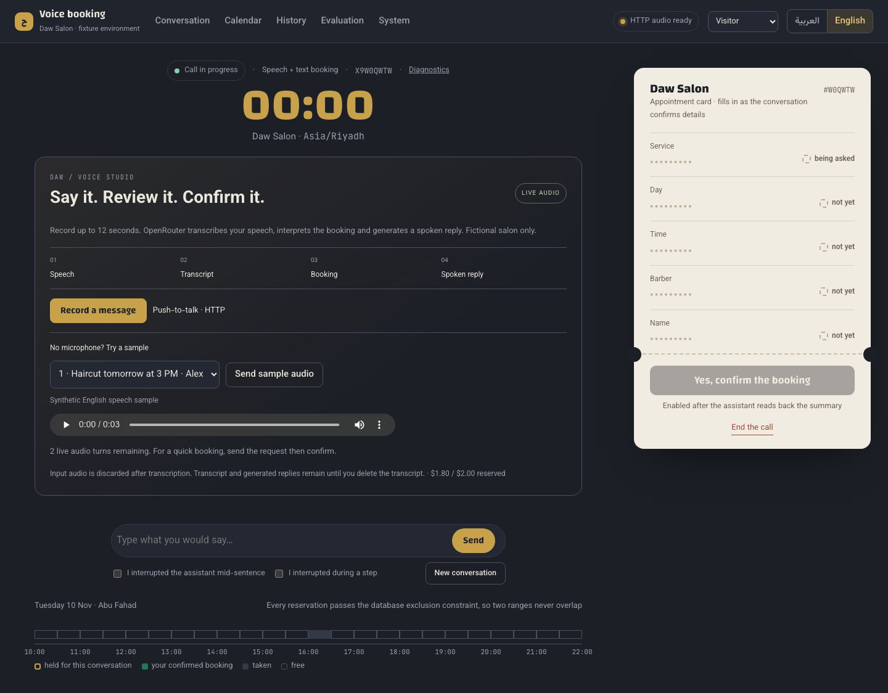

# Voice Booking

**Say it. Check it. Book it.**

Speech is ambiguous, and a booking is a state change. Voice Booking separates what was heard, what was interpreted and what the user actually confirmed.

Built by **Mohammed Abumtary** · TypeScript · React · PostgreSQL · speech transcription · dedicated speech synthesis

[Demo guide](docs/DEMO.md) · [Engineering notes](docs/ENGINEERING.md) · [Verification & boundaries](docs/VERIFICATION.md) · [Recorded walkthrough](media/walkthrough.webm)

## The experience

Speak or use a sample → inspect the interpretation → confirm a sample booking.

Real speech providers tested with synthetic English audio over a fictional calendar. The recorded journey includes transcription, booking and spoken replies. HTTP push-to-talk is supported; a completed WebRTC deployment is not claimed.

## Where the engineering matters

### Show the interpretation before commitment

The interface exposes transcript and booking summary. A correction changes the proposed time before a confirmation creates the booking.

### Keep speech consistent with state

Dedicated speech synthesis reads the authoritative response. The recorded reply is independently transcribed to check that an unconfirmed hold is not spoken as a completed booking.

### Make the reference intelligible

A discovered spoken-reference mismatch led to explicit digit pronunciation, then a second transcription check against the stored booking reference.

## Verified in the demonstration

- Recorded synthetic spoken request, time correction and explicit confirmation, with a matching persisted calendar entry.
- Independent transcription checks of the generated replies, including the final booking reference.
- Typed interaction remains available when microphone or live provider access is unavailable.
- 20 unit, 15 database and eight browser checks passed; both builds passed.

## Explore the work

This private repository is a presentation package: screenshots, walkthrough media and engineering notes. Application source, credentials and customer records are not included. The interactive demonstration runs in a separate local review environment; access can be arranged for a walkthrough.

[Read the guided demo](docs/DEMO.md) · [View my portfolio](https://mohammed-ab.github.io/)

## Scope

Fictional bookings only. Live microphone capture depends on browser permission and available allowance. Telephony, physical-device audio and a production LiveKit deployment are not established by this recording.

Reviewed 10 November 2026. Results describe the recorded build and stated test scope.
